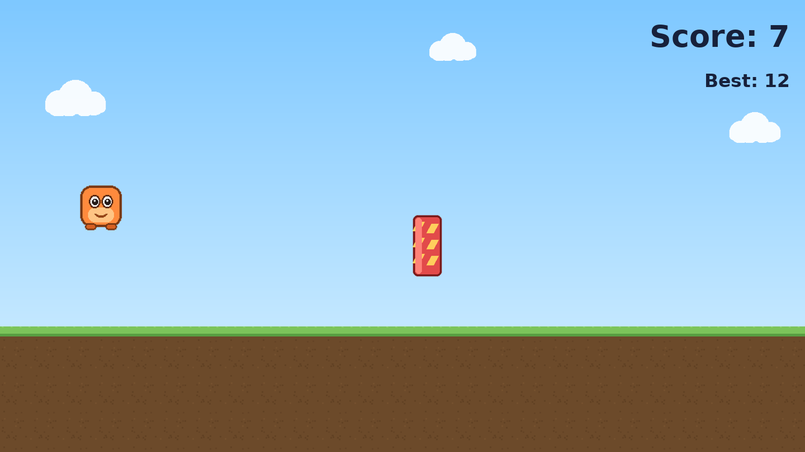
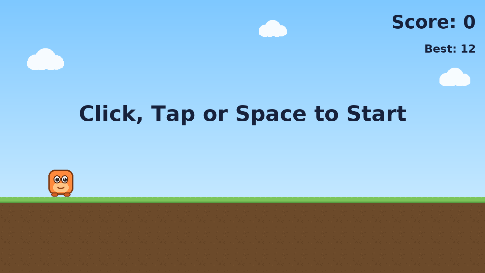
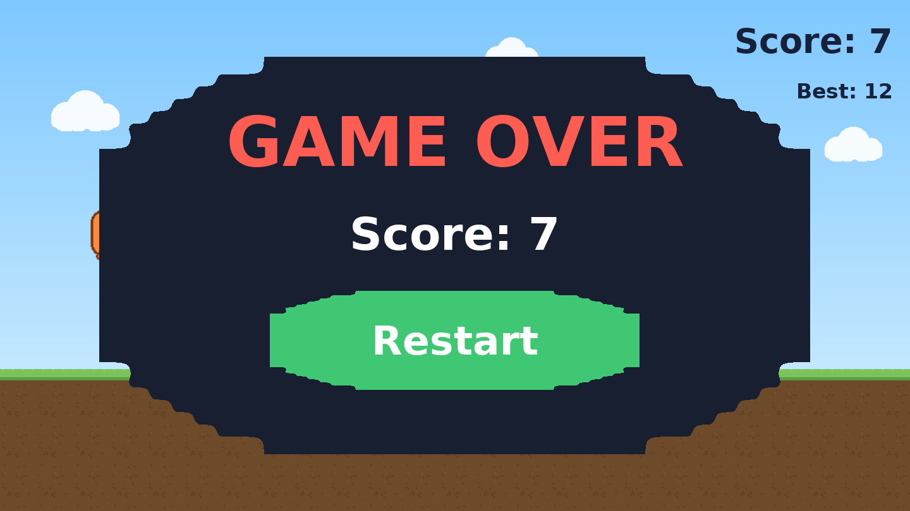

# Square Jumper — a beginner 2D obstacle-jumping game for Unity 2022.1

A small, complete, runnable Unity 2D game: a square character jumps over red
obstacles, the score goes up for every obstacle it passes, and hitting one shows
**Game Over** with the final score and a **Restart** button.

Built with Unity's **built-in 2D physics** (`Rigidbody2D`, `BoxCollider2D`,
`Physics2D` raycasts) and plain C# — no packages beyond `com.unity.ugui`, which
ships with every Unity install.



| Start screen | Game Over |
|---|---|
|  |  |

> The pictures above are rendered previews of the actual scene layout
> (`Tools/render_preview.py`), not screenshots of the editor.

---

## 1. Requirements

| You need | Version |
|---|---|
| Unity Hub | 3.4.1 (any recent Hub works) |
| Unity Editor | **2022.1** (the project is pinned to `2022.1.24f1`) |
| Target platform | Windows / macOS / Linux standalone, or WebGL |

The project uses the built-in **2D (Core)** render pipeline. No Universal RP,
no Input System package, no TextMeshPro — nothing to install.

## 2. Open and run the game

1. Open **Unity Hub** → **Projects** → **Add** → pick the folder that contains
   this `README.md` (the folder with `Assets`, `Packages`, `ProjectSettings`).
2. Open it with **Unity 2022.1.x**. If the Hub offers to upgrade the project,
   choose the 2022.1 version — do **not** upgrade it to a newer major version.
3. Unity imports the assets (a few seconds) and opens `Assets/Scenes/Game.unity`
   automatically. If it does not, double-click the scene in the **Project** window.
4. Press **Play** (▶ at the top of the editor).

### Controls

| Action | Input |
|---|---|
| Start the game | Left click / tap / **Space** (or the on-screen hint) |
| Jump | Left click / tap / **Space** |
| Restart after Game Over | Click / tap the **Restart** button |

### How the game works

* The player stands still at the left; the **obstacles move towards it**.
  (This is the "endless runner" trick: one moving object instead of a scrolling
  world, which keeps the camera and physics simple and fair.)
* Every obstacle that passes behind the player is worth **1 point**.
* The game gets harder slowly: the obstacles speed up (4.5 → 15 units/s) and
  arrive closer together (1.7 s → 0.85 s).
* Touching an obstacle ends the run and shows the final score plus your best
  score so far.

## 3. What is in the repository

```
Assets/
  Art/Sprites/            Player, Obstacle, Ground, GroundGrass, Cloud, SkyGradient, UIRoundedBox
  Prefabs/Obstacle.prefab the obstacle that gets spawned (Sprite + BoxCollider2D + ObstacleMover)
  Scenes/Game.unity       the whole game: camera, ground, player, spawner, HUD, Game Over panel
  Scripts/
    GameManager.cs        score, start, game over, best score, restart
    PlayerController.cs   jumping + ground check (Physics2D raycast)
    PlayerCollision.cs    "I touched an obstacle -> game over"
    ObstacleMover.cs      moves an obstacle left, scores it when it is passed
    ObstacleSpawner.cs    spawns obstacles, handles the difficulty curve
    BackgroundScroller.cs optional scrolling clouds (safe to remove)
Docs/
  STEP-BY-STEP.md         the full tutorial: build this game yourself from an empty project
  preview-*.png           rendered previews of the scene
Tools/                    Python helpers (sprite generator, scene/metadata builder, validators)
ProjectSettings/          pinned to Unity 2022.1 with the Obstacle tag already created
Packages/manifest.json    minimal package list
```

### Objects in `Game.unity`

```
Main Camera          orthographic, size 6, position (0, 0, -10)
Background           8x256 px sky gradient stretched over the view
Cloud 1..3           decorative, drift with BackgroundScroller
Ground               collider top at y = -2, dirt fill below it
GroundGrass          the green strip along the top of the ground
Player               PlayerController + PlayerCollision + Rigidbody2D + BoxCollider2D
ObstacleSpawner      creates Obstacle prefabs
GameManager          score + game state, wired to every UI element
Canvas               ScoreText, BestScoreText, TapToStart, GameOverPanel
  GameOverPanel      GameOverTitle, FinalScoreText, RestartButton (Text)
EventSystem          lets the mouse/touch click the Restart button
```

## 4. The three scripts you will care about

All of them expose their values in the **Inspector**, so you can tune the game
without touching code.

| Script | Attached to | What the important Inspector fields do |
|---|---|---|
| `PlayerController` | **Player** | `Jump Force` 12 (higher = jumps higher), `Ground Check Distance` 0.12, `Use Mouse And Touch` / `Use Space Bar` |
| `ObstacleSpawner` | **ObstacleSpawner** | `Obstacle Prefab`, `Spawn X` 11, `Min Y` -1.4, `Max Y` -0.4, `Start Speed` 4.5, `Max Speed` 15, `Start Spawn Interval` 1.7, `Min Spawn Interval` 0.85 |
| `GameManager` | **GameManager** | `Player`, `Spawner`, `Score Text`, `Game Over Panel`, `Final Score Text`, `Tap To Start Text`, `Best Score Text`, `Points Per Obstacle` |
| `PlayerCollision` | **Player** | `Obstacle Tag` = `Obstacle` |
| `ObstacleMover` | **Obstacle prefab** | `Speed`, `Pass X` -7 (where the point is awarded), `Destroy X` -14 |

### Tuning cheat-sheet

| I want to… | Change |
|---|---|
| Jump higher | `PlayerController.jumpForce` ↑ (higher) — or the Rigidbody 2D `Gravity Scale` ↓ |
| Make the game faster | `ObstacleSpawner.startSpeed` ↑ and `startSpawnInterval` ↓ |
| Make it harder sooner | `speedIncreasePerSecond` ↑ and `intervalStepPerSecond` ↑ |
| Change a point's value | `ObstacleMover.scoreValue` (or `GameManager.pointsPerObstacle`) |
| Different colours / art | replace the PNGs in `Assets/Art/Sprites` (keep the same file names, or update the sprites in the Inspector) |

> **Safety check before you change jump numbers:** run
> `python Tools/simulate_game.py`. It re-implements the physics and tells you
> whether the highest obstacle is still reachable. With the shipped values the
> jump apex is **3.34 units** and the tallest obstacle top is **2.60 units**
> above the ground, so every obstacle is always clearable.

## 5. Build a standalone version

1. **File → Build Settings…**
2. `Assets/Scenes/Game.unity` is already in **Scenes In Build** (ticked).
3. Pick **Windows / macOS / Linux** → **Switch Platform** → **Build**.
4. Choose an output folder outside the project (for example `../Builds`) so the
   generated files never end up in git (the `.gitignore` also covers `Build/`).

For a browser build choose **WebGL**; nothing in the game uses features WebGL
does not support.

## 6. Troubleshooting

| Symptom | Fix |
|---|---|
| `The type or namespace name 'Text' could not be found` | The `com.unity.ugui` package is missing — **Window → Package Manager → + → Add package by name → `com.unity.ugui`** (or just re-open the project; it is listed in `Packages/manifest.json`). |
| The player falls through the ground | The ground's `BoxCollider2D` must cover the visible ground. In this scene it is 60 × 12 centred at y = -8, so its top edge is y = -2. |
| The player never lands / can jump twice | Increase `Ground Check Distance` slightly (0.12 → 0.2) and make sure the ground is on a layer included in `Ground Layers`. |
| Hitting an obstacle does nothing | The prefab's tag must be **Obstacle** (Project Settings → Tags and Layers) and `PlayerCollision.Obstacle Tag` must match. |
| The Restart button does nothing | The scene needs the **EventSystem** object (it is included). Also check the Button's `On Click ()` list still points at **GameManager → RestartGame**. |
| `ObstacleSpawner has no Obstacle Prefab assigned` warning | Drag `Assets/Prefabs/Obstacle.prefab` into the spawner's `Obstacle Prefab` slot. |
| Text is invisible | Legacy `Text` needs the built-in font. If it is set to *None*, choose `LegacyRuntime.ttf` (Unity 2022) or `Arial.ttf` (older versions). |

## 7. Rebuilding the scene from scratch

The tutorial in **[Docs/STEP-BY-STEP.md](Docs/STEP-BY-STEP.md)** walks through
creating this exact game in an empty Unity 2022.1 project, one menu click at a
time — scripts, GameObjects, every Inspector value, and the reasoning behind it.

The files in `Assets/` are generated from small Python helpers so that every
reference stays consistent. They are committed as normal Unity assets and Unity
never needs them; only run them if you want to regenerate the scene after a big
change:

```bash
python Tools/generate_sprites.py     # redraw the PNGs
python Tools/build_unity_assets.py   # rewrite .meta files, Obstacle.prefab, Game.unity
python Tools/validate_assets.py      # check every fileID/guid reference
python Tools/render_preview.py       # refresh Docs/preview-*.png
```

Requires Python 3.9+ with `pillow` and `pyyaml` (`pip install pillow pyyaml`).

## 8. Where to go next

* Add a particle burst on crash (`GameManager.onGameOver` is an empty UnityEvent
  you can hook up in the Inspector — no code needed).
* Add background music / a jump sound: drop audio files in `Assets`, add an
  `AudioSource` to the player, call `audioSource.Play()` in `PlayerController`.
* Make it a real endless runner: un-freeze the X axis, move the player right and
  recycle the ground (the technique is described at the end of the tutorial).
* Swap the placeholder squares for your own art — same file names, or drag new
  sprites onto the `Sprite Renderer` components.
